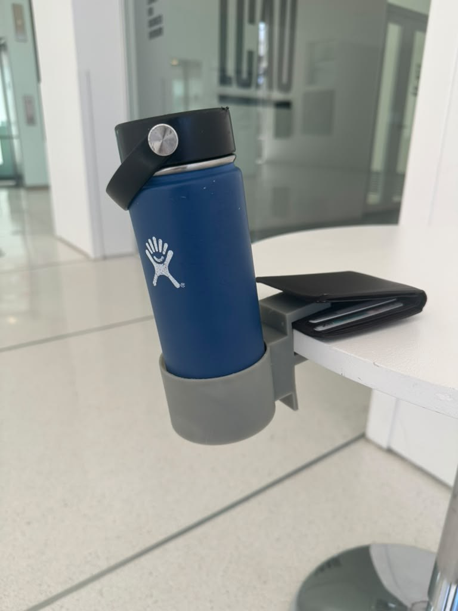
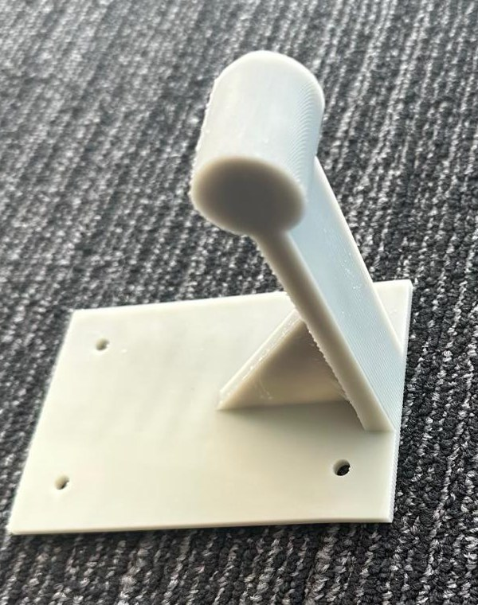
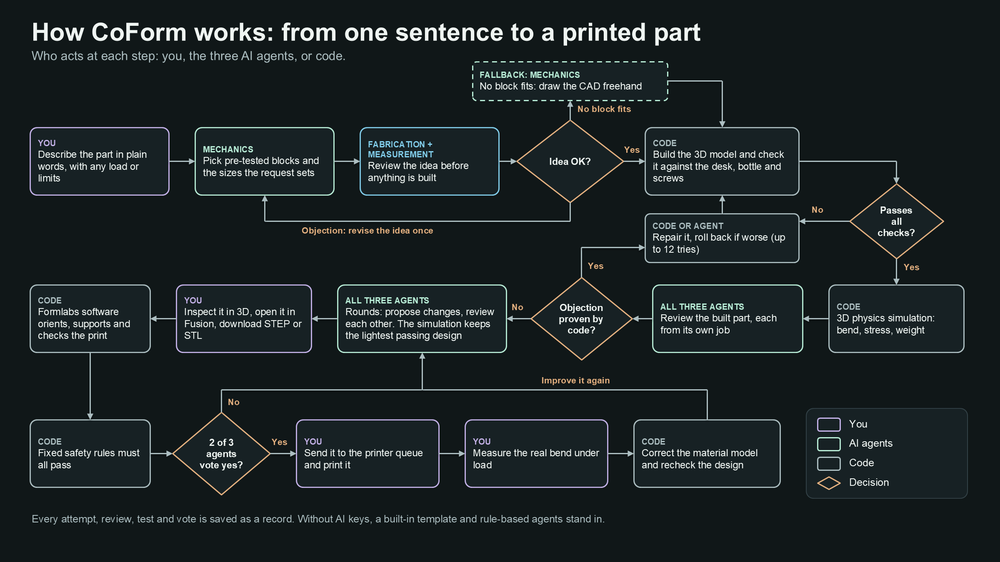
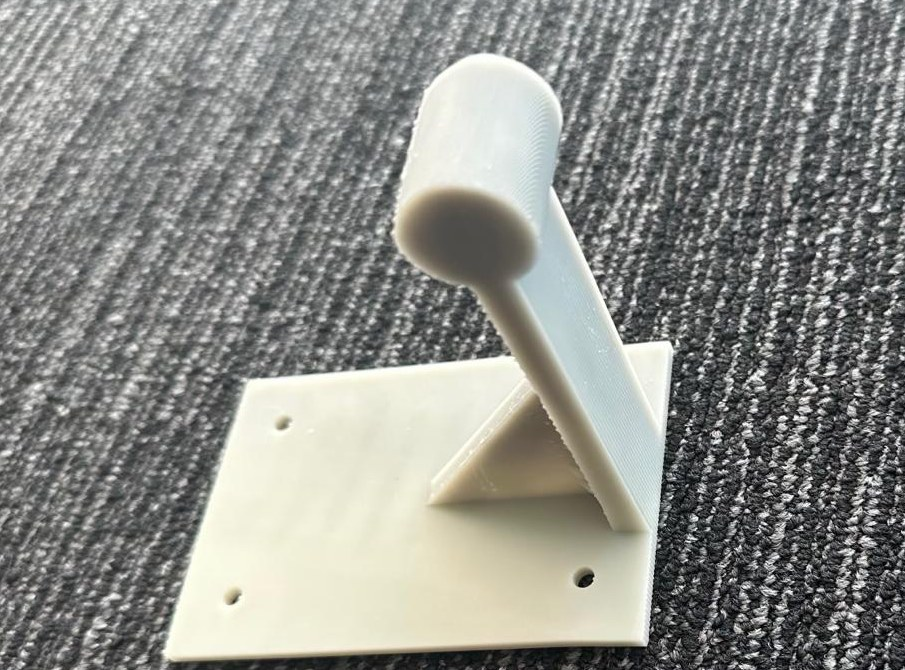
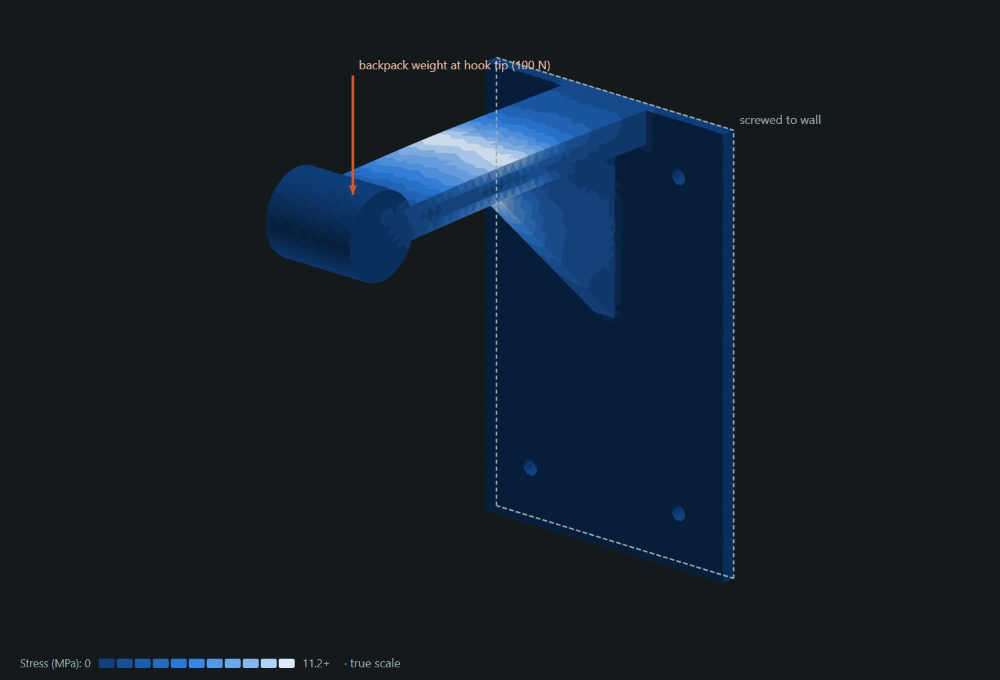
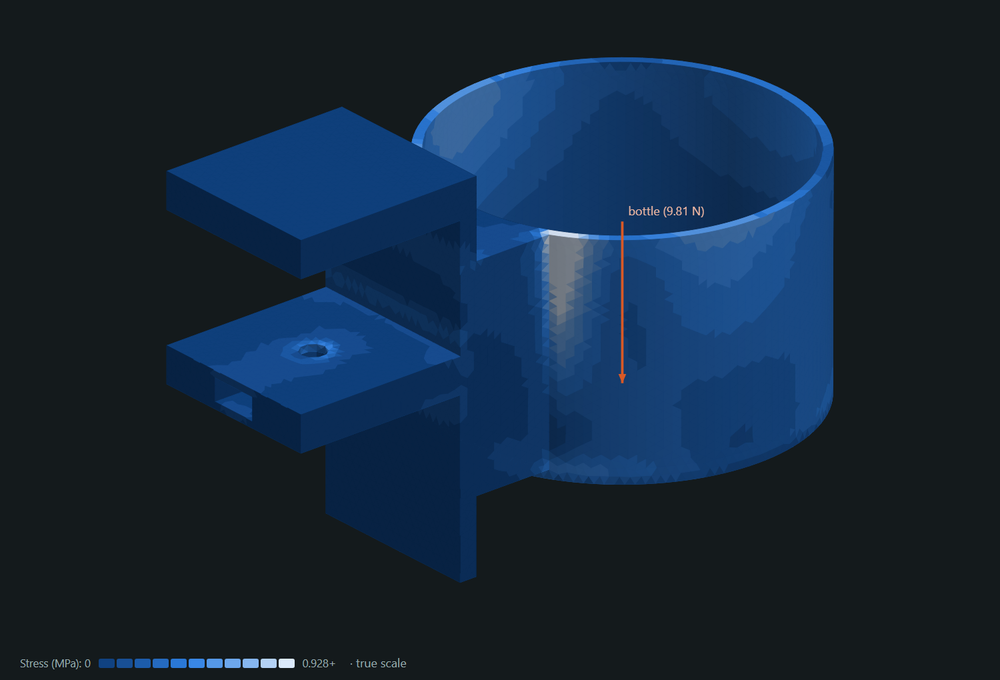
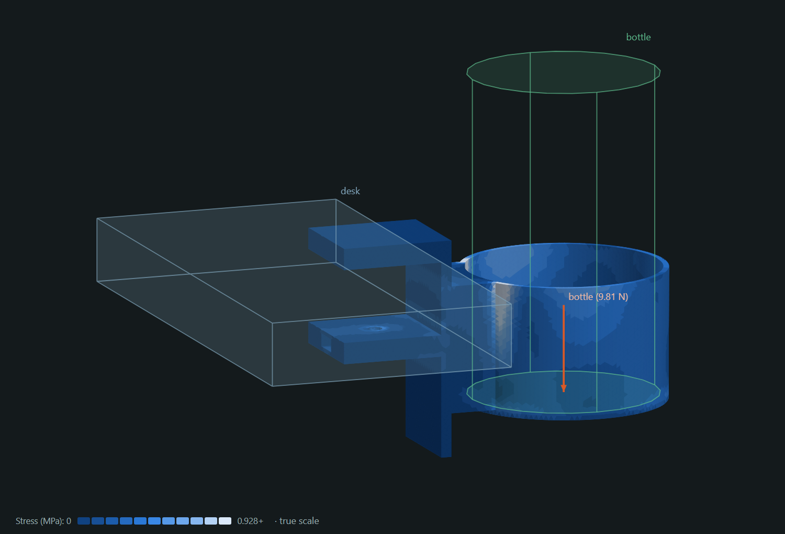
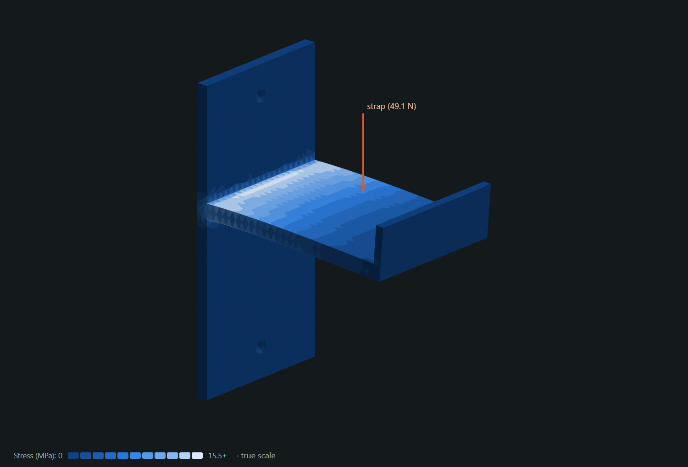

# CoForm: AI agents that design, test and print physical parts

> Built at the **ScienceClaw hackathon**, MIT Media Lab, October 30 to November 1, 2026.
> Challenge area **A·03 Manufacturing & Materials** (from candidate discovery to fabrication),
> with elements of **A·02 Physical Agency** (the agents drive CAD, a finite-element test rig and a
> Formlabs printer's software).

Describe a part in plain words, for example *"build a water bottle holder which can attach to a desk
and hold it"*. Three AI agents (mechanics, fabrication and measurement) agree on a design idea. Code
builds it as parametric CAD and checks it against the desk, bottle and screws it must work with. The
agents then make it lighter, with a 3D physics simulation picking the winner, and vote on whether it
may go to the printer queue. No agent directs the others, and no agent's claim counts until code has
measured it.

<p align="center">
  
  
</p>
<p align="center"><sub>Two parts our AI agents designed from one sentence each, printed in resin. Left: the desk-edge
water bottle holder, clamped on a table edge and holding a full insulated bottle. Right: the wall-mounted
backpack holder.</sub></p>

This README follows the hackathon's brief: each project must show a **problem**, a
**functioning system**, a **result** and **validation**. Judging weighs significance (20%),
impact (25%), decentralized agency (20%), collective capability (25%) and execution (10%).
Each section below answers one of those.

| Hackathon asks for | Where it is in this README |
|---|---|
| Problem, significance and complexity (20%) | [The problem](#the-problem) |
| Functioning system | [How it works](#how-it-works) and [What the app does](#what-the-app-does) |
| Decentralized agency (20%) | [The three agents](#the-three-agents-and-where-they-come-from) |
| Result, scientific and technical impact (25%) | [Results: three parts](#results-three-parts-the-agents-designed) |
| Collective capability (25%) | [Does the collective add capability?](#does-the-collective-add-capability) |
| Execution and validation (10%) | [Validation and limits](#validation-and-limits) |

The judging deck is [presentation/judge-ready/CoForm_Judge_Ready_v2.pdf](presentation/judge-ready/CoForm_Judge_Ready_v2.pdf)
(editable: [.pptx](presentation/judge-ready/CoForm_Judge_Ready_v2.pptx)).

## The problem

Getting a small functional part from an idea to a printer still takes a person who can do CAD, judge
the strength and know the printing process. Most people have none of those skills. A language model
can describe a bottle holder, but it cannot be trusted to place hundreds of coordinates correctly:
asked to draw the whole part, our AI put clamp jaws inside the desk and left pieces 18 mm apart.
A "passing" simulation also proves little if nobody checked that the part fits the desk, can be
screwed on, or lets the bottle drop in.

Three things make it hard:

- **The part must work, not just be strong.** It has to fit the body it attaches to, touch the
  right faces, let things be inserted and hold them in, and print without trapping resin.
- **No single discipline owns the answer.** Structure, printability and testability pull in
  different directions: lighter is weaker, and supports scar the faces that do the work.
- **Evidence has to beat confidence.** Agents confidently claim failures that are not there. In
  our runs a reviewer twice called a drain hole blind while the measured geometry showed it went
  through. Something has to settle such disputes with measurements.

Our approach: **the agents make the decisions, and code draws the exact geometry and proves it works.**

## How it works

<p align="center"></p>

1. **Design idea.** The mechanics agent picks pre-tested building blocks and the sizes the request
   sets, for example *"desk clamp plus cup, 25 mm desk, 75 mm bottle, 1 kg"*. That reply is about
   300 tokens, where a freehand drawing of the whole part is about 3,000. Fabrication and
   measurement review the idea before anything is built, and an objection sends it back once. The
   blocks are a C-clamp with a thumb screw in a captive nut, a cup with a drain, a cradle for a
   tube, a wall plate with screws and a hook. Mechanics can mount a cup, cradle or hook on a desk
   edge or a wall, and each block is built to fit the body it serves. If no block fits the request,
   mechanics draws the CAD freehand instead.
2. **Build and check.** Code builds one solid with the Gmsh/OpenCASCADE kernel and checks it
   against the world it works in (desk, wall, bottle, strap, screws):
   - **fit:** no material inside any body,
   - **contact:** it touches the faces it must,
   - **insertion:** every item and tool has a clear path into place,
   - **retention:** the item is blocked in every direction that matters,
   - plus trapped resin, a closed surface, minimum wall thickness and the printer's build volume.

   A failure goes to the repair loop: code fixes what it can measure exactly (for example joining
   pieces that do not touch), otherwise the agent edits the design. Code keeps the best version and
   rolls back any repair that makes things worse, for up to 12 attempts.
3. **Simulate.** Only a part that works is tested for strength: a 3D finite-element simulation
   (Gmsh and CalculiX) with Formlabs Alpha Fast Resin properties gives bend, stress and weight.
4. **Review.** Each agent reviews the built part from its own job. A blocking objection must be a
   claim code can check, such as "hole radius < 3.2 mm". Code measures each claim. A claim that the
   measurement still contradicts after one clarification round is overruled and kept as a note.
5. **Optimize.** In each round, mechanics and fabrication propose dimension changes, measurement
   writes the physical test plan, and all three review each other's proposals. Code simulates every
   proposal, and the lightest design that still passes wins.
6. **Print.** Formlabs PreForm orients, supports and checks the part. Fixed safety rules (PreForm
   grade, part checks, minimum wall) cannot be waived. Then at least two of the three agents must
   vote yes, each giving reasons and suggestions, before you can send it to the printer queue.
7. **Measure.** You enter the measured bend of the printed part. Code corrects its material model
   with that number and rechecks the design, and the agents can improve it again.

Everything is saved as append-only, hash-chained records: every attempt, reply, review, test and
vote. Any decision can be traced to its evidence.

## The three agents and where they come from

**Where they come from.** All three agents are the same AI model, **NVIDIA Nemotron 3 Ultra**,
called through NVIDIA's hosted API. They are not separately trained models. What makes each one a
specialist:

- **its own job description**, sent with every call: what it owns and what it may change,
- **its own powers, enforced by code**: measurement can never change the shape, and no agent can
  overrule a measurement,
- **only the evidence**: each call gets the request, the measured results and the saved history,
  with no hidden shared plan.

They never chat directly. They post proposals, reviews and votes to a shared record that code
checks. Any role can be switched to OpenAI, Anthropic or Gemini in `.env`.

| | Mechanics | Fabrication | Measurement |
|---|---|---|---|
| Cares about | Will it hold the load? | Can it print, and with how little resin? | Can we test the real part? |
| Design idea | Proposes the blocks and sizes | Reviews: can it print? | Reviews: can it be tested? |
| Optimization | Proposes stronger shapes | Proposes lighter shapes, spots print problems | Writes the test plan, never changes the shape |
| Print vote | Bend and stress margins | PreForm report, minimum wall | Is the bend measurable? |
| In our runs | Chose the desk clamp and cup | Cut the backpack holder from 118.5 g to 99.1 g | Confirmed the bottle holder's 0.08 mm bend is 8x what a dial gauge reads |

**How decisions are made, without a master agent.** One agent proposes the design idea and the
other two review it. In optimization, any agent may propose, and the simulation, not a vote, picks
the winner. Printing needs two independent yes votes. **Code is the referee, not a player:** it
builds what the agents choose, measures their claims and enforces the rules, but it never picks
the design. An objection that code verifies cannot be outvoted, and one it disproves cannot block.

## Results: three parts the agents designed

All three were designed by the live agent team (Nemotron 3 Ultra) from one plain-language request
each, with no human CAD.

### 1. Wall-mounted backpack holder (printed)

> *"Create a wall mounted backpack holder, make sure there is no extrusions through the wall
> mounted holder and also make sure there no [holes] which resin can get trapped in without
> draining properly"*

<p align="center">
  
  
</p>
<p align="center"><sub>Left: the printed part. Right: the same design in CoForm's 3D viewer. Lighter color means
more stress, highest where the arm meets the plate.</sub></p>

The agents designed a vertical back plate screwed to the wall, a horizontal arm with a round hook
tip, and a triangular gusset at the joint. Every screw hole and the drain at the tip goes all the
way through, so no liquid resin is trapped. It carries a 100 N (about 10 kg) backpack at the tip.

| | First design | After optimization (adopted) | Limit |
|---|---|---|---|
| Weight | 118.5 g | **99.1 g (-16%)** | none set |
| Bend at the load | 1.30 mm | 1.81 mm | 2 mm |
| Peak stress | 8.4 MPa | 11.6 MPa | 23 MPa (strength / safety factor 2) |

In round 1, fabrication's proposal (thinner back plate, gusset and arm) won on the simulation over
mechanics' lighter one, which bent 2.52 mm. Eight more rounds found nothing lighter that still
passed. PreForm graded the part WARN (3.9% of the surface not fully supported, no failures), with an
estimate of 1.5 h and 117 mL of resin including supports. All three agents voted to print, and it
has been printed. It has not been load tested yet. This part was drawn freehand by the agents,
before the design-idea step existed, so its wall mounting and load were written as hold and load
regions rather than checked against a wall body.

### 2. Desk-edge water bottle holder (printed and in use)

> *"build a water bottle holder which can attach to a desk and hold it"*

<p align="center">
  
  
  
</p>
<p align="center"><sub>Left: the printed part, clamped on a table edge and holding a full insulated bottle. Middle:
the agents' design in CoForm's 3D viewer, with upper and lower jaws (thumb-screw hole and slide-in nut
slot), spine past the desk edge, web and cup. Stress peaks where the web meets the cup. Right: the
virtual desk and bottle its fit was checked against.</sub></p>

Mechanics chose a desk-edge clamp plus a cup, for a 1 L bottle (75 mm across, 200 mm tall, 1 kg) on
a 25 mm desk. The request gave no sizes, so these were tested defaults, reported as assumptions.
Fabrication and measurement approved the idea, and code assembled it: a C-clamp with an M6 thumb
screw in a captive nut, a cup with a drain hole, and a web joining them. It passed every check on
the first try, including fit, contact, insertion and retention against the desk, bottle, screw and
nut.

| | First design | After optimization (adopted) | Limit |
|---|---|---|---|
| Weight | 158.1 g | **125.4 g (-21%)** | none set |
| Bend at the load | 0.03 mm | 0.08 mm | 2 mm |
| Peak stress | 0.38 MPa | 0.76 MPa | 23 MPa |
| Size | 139 x 83 x 89 mm | 138 x 81 x 85 mm | 200 x 125 x 210 mm build volume |

Choosing and reviewing the design idea took 3 model calls and 3,123 tokens. The three agents
approved the built design. In round 1, mechanics' change won, and eight more rounds found nothing
lighter. PreForm graded the part WARN (0.5% of the surface unsupported), with an estimate of 1.8 h
and 157 mL of resin including supports, and the agents voted 3 of 3 to print. We printed it, and
it grips a real table edge and holds a full insulated bottle (photo above). Its bend has not been
measured yet.

### 3. Wall hook for a backpack (latest run)

> *"generate me a wall mounted hook [which] i can hang my backpack from"*

<p align="center"></p>

Mechanics chose a wall plate plus a hook for a 5 kg backpack (40 mm strap). The first assembled
version passed every check, but the review asked for one repair before it was accepted. Over 12
optimization rounds the agents took turns improving it: mechanics' changes were adopted in rounds
1, 2 and 8, and fabrication's in rounds 6 and 9.

| | First accepted design | Best design (round 9) | Limit |
|---|---|---|---|
| Weight | 44.2 g | **22.9 g (-48%)** | none set |
| Bend at the 49 N load | 0.21 mm | 1.87 mm (93% of the limit) | 2 mm |
| Peak stress | 3.6 MPa | 15.7 MPa | 23 MPa |

This hook has not been through print preparation yet.

## Does the collective add capability?

We measured this rather than assumed it. The answer depends on the task.

**On a narrow numeric task, no.** On the beam-study benchmark, the agents size a printed support
beam on a simulated test rig with equal budgets. Each method had 4 runs: 2 scenarios x 2 seeds,
Alpha Fast resin, all agents on Nemotron 3 Ultra.

| Method | Passed | Runs that saved material | Mean volume vs reference | Tokens per run | Calls per run |
|---|---|---|---|---|---|
| Adaptive numerical optimizer (no AI) | 4/4 | 4/4 | **0.76** | 0 | 0 |
| Three agents (collective) | 4/4 | 1/4 | 0.93 | 161k | 48.5 |
| One agent with the same tools | 4/4 | 2/4 | 0.88 | 31k | 7.8 |
| Three agents without evidence exchange | 4/4 | 2/4 | 0.87 | 52k | 21 |

In a second set (nominal and soft-material scenarios, agents on the smaller Nemotron 3.5
Lightning), the optimizer reached 0.69 and no AI method improved on the reference. For tuning a few
numbers against a known model, a plain optimizer wins, and the collective costs the most. Data:
`data/comparison-live-alpha-fast/` and `data/comparison-live-nemotron/`.

**On open-ended design, the collective's job is judgment, not arithmetic.** We moved the agents to
the decisions only they can make: which mechanism, whether it can print, and how it will be tested.
Code does the millimeters. On the bottle-holder request, the overnight freehand runs (one model
writing the whole CAD) never produced a design that passes today's checks. One passed the older
checks, but its clamp jaw filled the gap meant for the desk. It is kept as a regression test
(`tests/fixtures/live_bottle_holder.json`). With design ideas from pre-tested blocks, the first live
run built and passed every check, though review then stopped it on claims the measurements
contradicted. After we made measurement the referee, the next run went from request to approved
print on its own. This is a before and after on one request, not a controlled comparison, because
the code and checks also changed between runs.

The reviewers also caught a real concern no automatic check covers: the clamp's M6 hole has no
clearance for the thread. It was raised as a should-fix and has not been fixed yet.

## What the app does

| Design | Check and simulate | Agents | Make and measure |
|---|---|---|---|
| Plain-language requests with optional load, bend, weight and safety limits | Checks against the real desk, wall, bottle and screws: no overlap, contact, insertion, holding | Mechanics, fabrication and measurement agents | 3D viewer colored by stress or bend, plus history charts |
| Design ideas from pre-tested blocks: desk clamp or wall plate with cup, cradle or hook | Trapped-resin, closed-surface, minimum-wall and printer-size checks | Design ideas reviewed before anything is built | STEP and STL export, Autodesk Fusion add-in, FreeCAD and Onshape |
| Code-built 3D CAD, AI drawing as a fallback | 3D physics simulation (finite elements) with Formlabs Alpha Fast Resin | Peer review with claims that code measures and can overrule | Formlabs PreForm: orient, support, check, estimate, queue |
| Automatic repairs, rollback to the best version, a new design idea when stuck | Optimization rounds: the lightest passing design wins, with each check's margin to its limit shown | OpenAI, Anthropic, Gemini or NVIDIA per role, plus an offline mode | Print review: fixed safety rules plus 2 of 3 agent votes with suggestions |
| Design intent, assumptions and every attempt shown in the app | Beam-study lab: model fitting, diagnosis and method comparisons | Token budgets, spending limits, retries and resume after interruption | Measured bend corrects the model, and every decision is recorded |

## Validation and limits

**Verified in software**
- 348 automated tests. They cover the component library, every design-idea combination at both
  ends of its tested size ranges, the function checks, repair and rollback, review arbitration,
  print rules and votes. Fake agents exercise the whole pipeline without spending credits.
- Finite-element results are checked against linear-elastic scaling (twice the stiffness gives
  half the bend). The CAD-kernel volumes and second moments match beam formulas.
- Real PreForm 3.65 preparations of the backpack holder and the bottle holder, with PreForm's own
  checks: manifold, in bounds, no resin cups, no thin walls.

**Physically demonstrated**
- The backpack holder and the bottle holder have both been printed from the agents' designs
  (photos above).
- The printed bottle holder grips a real table edge and holds a full insulated bottle.

**Not yet established**
- No printed part's bend has been measured yet. The measurement loop (measured bend, then a
  corrected material model, then a recheck) is implemented and tested with simulated numbers.
- Strength and bend are finite-element predictions using datasheet resin properties. They are not
  certified ratings.
- The comparison is small (4 runs per method) and uses a simulated rig. It shows where the
  collective does not help. It does not prove the general case either way.
- The pre-tested blocks cover desk edges and walls holding cups, cradles and hooks. Other mechanisms
  fall back to freehand drawing, which is much less reliable.

## Run it

Requires Python 3.11+, and FreeCAD 1.1 for its bundled Gmsh and CalculiX finite-element tools.
Formlabs PreForm is needed only for print preparation.

```powershell
python -m venv .venv
.\.venv\Scripts\python.exe -m pip install -e ".[dev,formlabs]"
.\.venv\Scripts\python.exe -m coform.cli serve
```

Open **http://127.0.0.1:8000/designer** and describe a part. Without API keys, a built-in template
and rule-based agents stand in, labeled as such. To use live agents, copy `.env.example` to `.env`
locally and set each role's provider, for example:

```
MECHANICS_PROVIDER=nvidia
FABRICATION_PROVIDER=nvidia
MEASUREMENT_PROVIDER=nvidia
NVIDIA_API_KEY=...            # never commit keys
NVIDIA_MODEL=nvidia/nemotron-3-ultra-550b-a55b
```

Run the tests with `.\.venv\Scripts\python.exe -m pytest -q`.

## Repository map

| Path | What it does |
|---|---|
| `coform/designer.py` | The designer: design idea, drafting, review, optimization and print stages |
| `coform/concepts.py` | Design-idea catalog and assembly: tested mounts and holders, sizes within tested ranges |
| `coform/components.py` | Pre-tested blocks built from the body they serve: clamp, cup, cradle, wall plate, hook, join |
| `coform/freeform.py` | Parametric CAD spec, solid build, meshing and finite-element analysis |
| `coform/scene.py` | Fit, contact, insertion and retention checks against the reference bodies |
| `coform/designer_repair.py` | Repairs, redesigns, and the machine-checkable review claims |
| `coform/agents.py`, `coform/providers.py` | Metered model calls, with OpenAI, Anthropic, Gemini and NVIDIA adapters |
| `coform/formlabs.py` | Formlabs PreForm integration: preparation, checks, printer queue |
| `coform/fusion.py`, `fusion/` | Autodesk Fusion add-in: open any tested design in Fusion |
| `coform/static/` | The web interface |
| `presentation/` | Judging deck, application flowchart and the deck's build script |
| `docs/` | [Designer details](docs/designer.md), [beam-study lab](docs/study-lab.md), [Formlabs](docs/formlabs.md), [Fusion](docs/fusion.md), [validation status](docs/validation-status.md) |

The server binds to `127.0.0.1` and has no authentication. Keep it local.
