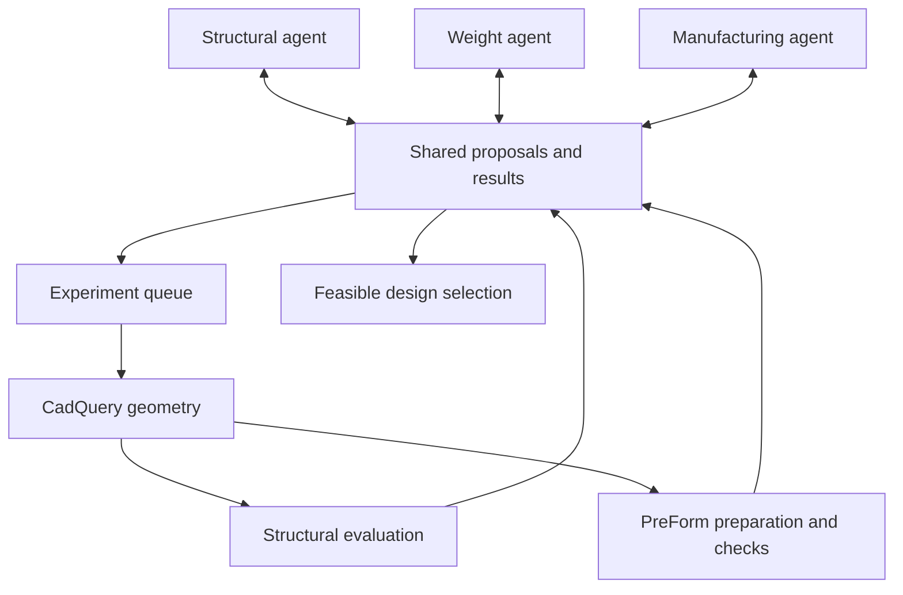

# Bracket Collective

A proposed multi-agent engineering system for designing and preparing a lightweight, ribbed L-shaped bracket for SLA resin printing.

**Status:** This README describes the planned prototype. It does not imply that the listed Python modules, integrations, or experiments have been implemented. The LLM provider, structural evaluator, exact printer model, and resin remain to be selected.

## Project goal

Investigate whether agents with different engineering responsibilities can jointly find better feasible designs within a fixed experiment budget than a single agent or conventional search method.

The initial objective is to **minimize finished-part mass while satisfying specified structural and manufacturing constraints**. A useful result includes a candidate design, traceable evaluations, and evidence showing whether collaboration improved the search.

The prototype uses:

- **CadQuery** to generate parameterized CAD geometry locally in Python.
- **A separate structural evaluator** to estimate mechanical performance.
- **Formlabs PreForm API** to prepare geometry for an SLA resin printer and collect manufacturing feedback.
- **Three LLM agents** to propose changes and exchange evidence.
- **Ordinary Python code** to validate proposals, schedule experiments, store results, and select feasible candidates.

Onshape is not required in this version. The CadQuery function is the editable design template.

## Initial design scope

The bracket consists of two perpendicular plates and a reinforcing rib.

| Adjustable geometry | Fixed for the first experiment |
| --- | --- |
| Plate thickness | Overall envelope and mounting geometry |
| Rib height | Material and mechanical assumptions |
| Rib thickness | Applied load and attachment conditions |
| | Stress and deflection limits |

The manufacturing agent can explore a bounded set of print orientations and support settings. Fix the printer, resin, supported print profile, layer thickness, and post-processing procedure initially.

All dimensions use millimeters. Record units for every measurement, including mass, force, stress, and deflection. Preserve the intended scale when exporting and importing STL files.

Parameter limits and load requirements must be chosen before optimization. Example dimensions in development code are not validated engineering recommendations.

## Agent responsibilities

| Agent | Decisions | Evidence |
| --- | --- | --- |
| Structural | Propose geometry changes to satisfy mechanical requirements. | Structural evaluation results and physical measurements. |
| Weight | Propose material reductions and alternative reinforcement arrangements within the supported parameterization. | Solid volume, estimated mass, and feasibility results. |
| Manufacturing | Propose orientation/support changes and request geometry revisions. | PreForm printability checks, calculated print time, and observed print outcomes. |

Agents may propose candidates, challenge interpretations, respond to another agent, or decline to request an experiment. They should reference actual candidate IDs and measurements rather than inventing results.

Agents do not directly overwrite a shared CAD model or execute arbitrary generated Python. They submit structured actions through validated tools.

## Architecture



The scheduler manages resources rather than prescribing the agents' design strategy. Start with round-robin selection among pending proposals and sequential execution. Agents retain ownership of hypotheses and follow-up decisions even when tool calls run sequentially.

A typical interaction:

1. The weight agent proposes a thinner plate.
2. CadQuery generates the candidate, and the structural evaluator measures its predicted behavior.
3. Excessive predicted deflection causes the structural agent to propose a taller rib.
4. The manufacturing agent tests preparation options and reports any printing issues.
5. An agent revises the candidate using both sets of evidence.
6. The scheduler evaluates the revision and publishes the results to all agents.

## Proposed files

Keep the first implementation flat; folders can be introduced when useful.

| File | Responsibility |
| --- | --- |
| `main.py` | Initialize a run and execute the proposal/generation/evaluation loop. |
| `config.py` | Load parameter bounds, engineering requirements, printer settings, budgets, and environment variables. |
| `schemas.py` | Pydantic definitions for parameters, proposals, messages, print settings, and results. |
| `bracket.py` | Build the parameterized solid with CadQuery, check geometry, calculate volume, and export STL/STEP. |
| `preform_client.py` | Wrap the Formlabs SDK for preparation, checks, time calculation, saving, and explicit job submission. |
| `structural_evaluator.py` | Run the selected mechanical analysis and return measurements plus analysis status. |
| `llm_client.py` | Wrap the chosen model provider and validate structured responses. |
| `agents.py` | Define agent instructions, context construction, and permitted actions. |
| `coordination.py` | Deliver messages, queue proposals, deduplicate experiments, and enforce budgets. |
| `store.py` | Persist run configuration, candidates, messages, results, and artifact paths. |
| `selection.py` | Identify feasible candidates and select the lowest-mass feasible result. |
| `requirements.txt` | Python dependencies. |
| `.env` | Local credentials and machine-specific configuration. |
| `.gitignore` | Exclude secrets, environment files, caches, and local run outputs. |
| `README.md` | Project purpose, architecture, setup, and implementation plan. |

Later additions may include `baselines.py`, a report generator, a dashboard, and a physical-test data importer.

## Data and tool interfaces

Keep geometry and manufacturing settings separate. A geometry change requires a new solid; an orientation change can reuse the same solid with a different print preparation.

Each proposal should include:

- Proposing agent and parent candidate ID.
- Complete geometry parameters and proposed print settings.
- Hypothesis, expected tradeoff, and supporting result references.

Each evaluation should include:

- Candidate ID and geometry/configuration identifiers.
- Status for every analysis: completed, failed, or not evaluated.
- Volume, estimated mass, stress, and deflection where actually available.
- PreForm check outcomes and calculated print time.
- Error details and paths to generated files.

Proposed application-level functions include:

```python
# Interface sketches, not implemented functions or SDK method names.
build_bracket(parameters)
export_geometry(solid, stl_path, step_path)
evaluate_structure(geometry, material, load_case)
prepare_print(stl_path, print_settings)
evaluate_printability(scene_id)
save_prepared_scene(scene_id, output_path)
```

Record complete evaluator configurations. Cache keys must include geometry, load/material settings, relevant tool versions, and print settings as appropriate. Changing the load creates a different structural experiment even when geometry is unchanged.

## PreForm integration

PreForm runs separately from the Python application. Your wrapper connects to its local API server using the Formlabs Python SDK.

The preparation workflow is:

1. Create a scene using the available printer, resin, and supported layer thickness.
2. Import the candidate STL.
3. Apply an explicit orientation or automatic orientation.
4. Generate supports and arrange the model.
5. Run relevant printability checks.
6. Calculate print time and save a `.form` file.
7. Submit selected jobs only when physical printing is intended.

Supported checks include unsupported minima, undersupported areas, thin walls, cups, interference, manifoldness, and build-volume limits. Thin-wall thresholds are inputs chosen by the application, not automatically established structural limits.

Inspect status fields as well as numerical results. A failed analysis must never count as a passing check. Save prepared scenes because live scene IDs and operations are tied to the running server session.

Print preparation and submission are separate actions. Many candidates can be evaluated digitally while only a small number are fabricated.

## Structural evaluation and physical testing

**PreForm printability is not structural validation.** CadQuery supplies geometry; a separate mechanical method must evaluate the specified load case.

Choose the structural evaluator before claiming strength or stiffness improvements. Depending on the solver, it may require a solid model or analysis mesh rather than the printing STL. Document loads, boundary conditions, material assumptions, and numerical settings.

A mock evaluator may be used to develop the software pipeline, but its results must be labeled synthetic and excluded from engineering claims. If structural analysis is absent, report `not evaluated`; do not label the candidate structurally feasible.

For physical validation, print the starting design and selected candidates, complete the specified post-processing, and measure mass and deflection using the same fixture and load procedure. Record preparation conditions and repeat specimens where feasible. A person can enter measurements; this is a human-assisted experimental loop.

If measurements change the agents' next proposal, the project demonstrates a design–test–revise loop. Printing a final part without testing it demonstrates fabrication only.

## Development setup

Setup commands below prepare dependencies. They do not create the proposed Python modules.

Use Python 3.11 or later, Git, and an API-capable PreForm installation. The Formlabs guide consulted for this plan specifies PreForm/Server 3.64+ and the Insider build for desktop scripting. Confirm compatibility with the hackathon-provided build; the documented API is alpha and may change.

Create and activate a virtual environment from the project directory:

```powershell
# Windows PowerShell
python -m venv .venv
.\.venv\Scripts\Activate.ps1
```

```bash
# macOS / Linux
python3 -m venv .venv
source .venv/bin/activate
```

In VS Code, select this environment as the Python interpreter.

Initial `requirements.txt`:

```txt
cadquery
python-dotenv
pydantic
formlabs-sdk @ git+https://github.com/Formlabs/formlabs-api-python

# Add the chosen LLM SDK and structural-solver dependencies later.
```

Install dependencies:

```bash
python -m pip install -r requirements.txt
```

Once the integration works, pin package versions and the Formlabs SDK commit for reproducible team setup.

Suggested `.env` placeholders, to be consumed by `config.py`:

```dotenv
LLM_API_KEY=replace_locally_after_choosing_provider
PREFORM_PORT=44388
```

These are application configuration names, not automatically recognized by every SDK. No Onshape credentials are needed. Keep secrets out of prompts and version control.

Suggested `.gitignore` entries:

```gitignore
.env
.venv/
__pycache__/
*.pyc
runs/
```

Excluded run artifacts should still be retained separately when needed as experimental evidence.

Start PreForm's server through **File → Start PreForm Server**. The documented default port is 44388. A minimal connection check is:

```python
from formlabs_sdk import FormlabsClient

with FormlabsClient() as client:
    preform = client.preform.connect()
    print(f"Connected to PreForm {preform.version}")
```

This check connects to the default local server and does not submit a print. Select actual printer/material identifiers from the running installation's supported print settings rather than copying unrelated example values.

## Implementation milestones

- [ ] Implement a valid, parameterized bracket in `bracket.py`.
- [ ] Export STL and STEP; confirm units, dimensions, and a valid single solid.
- [ ] Connect to PreForm and prepare one bracket with a saved `.form` output.
- [ ] Add structured printability results and persistent candidate records.
- [ ] Implement and validate the structural evaluator.
- [ ] Add one agent proposing bounded parameter changes.
- [ ] Add all three agents, shared evidence, and budgeted scheduling.
- [ ] Compare against single-agent and conventional-search baselines.
- [ ] Print and test selected specimens if hardware and time permit.
- [ ] Produce a report and optional dashboard.

The first milestone for the integrated application is: **generate a bracket → export STL → prepare it in PreForm → save the prepared job**.

There is no implemented application run command yet. `main.py` becomes the entry point once the modules above exist.

## Validation and collective advantage

Compare the collective with a single agent given the same tools and information, and with a simple parameter search. Use comparable structural-evaluation, print-preparation, and model-call budgets; report actual costs separately.

Use PreForm's automatic orientation and support generation as a preparation baseline so improvements are not incorrectly attributed to agent reasoning.

Useful metrics include:

- Lowest feasible finished-part mass found within the budget.
- Number of evaluations needed to reach a predefined target.
- Fraction of candidates satisfying all requirements.
- Calculated printing time and observed manufacturing outcomes.
- Agreement between simulated and measured mechanical performance.
- Differences across repeated runs, including unsuccessful runs.

The record should reveal concrete cases where one agent's evidence changed another's decision. If no collective benefit is observed, report that result rather than assuming multiple agents are inherently better.

## Expected outputs

- Candidate STL and STEP files.
- Prepared PreForm `.form` files.
- Structured experiment records and agent messages.
- A comparison table of feasible designs and tradeoffs.
- The selected design, or an explicit statement that no feasible design was found.
- Physical measurements when collected.
- Baseline comparisons supporting or limiting claims of collective advantage.

Predicted, software-checked, and physically measured results must remain distinguishable.

## Remaining decisions

- Exact SLA printer model, resin, layer thickness, and post-processing procedure.
- Bracket dimensions, parameter bounds, load case, and acceptance limits.
- Structural solver or calculation method and its validation approach.
- LLM provider/model and model-call budget.
- Available printing time, specimen count, and test equipment.

## References

- [CadQuery installation](https://cadquery.readthedocs.io/en/latest/installation.html)
- [CadQuery import and export](https://cadquery.readthedocs.io/en/latest/importexport.html)
- [Formlabs Developer Kit installation](https://developer.formlabs.com/getting-started/install/)
- [PreForm first-script walkthrough](https://developer.formlabs.com/getting-started/quickstart/)
- [PreForm model operations](https://developer.formlabs.com/api-reference/modifying-models/)
- [PreForm printability checks](https://developer.formlabs.com/api-reference/printability-checks/)
- [PreForm scene operations](https://developer.formlabs.com/api-reference/scenes/)
