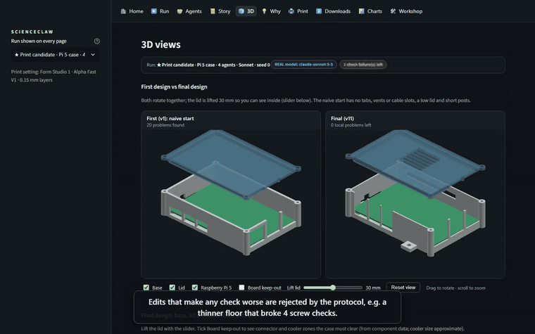
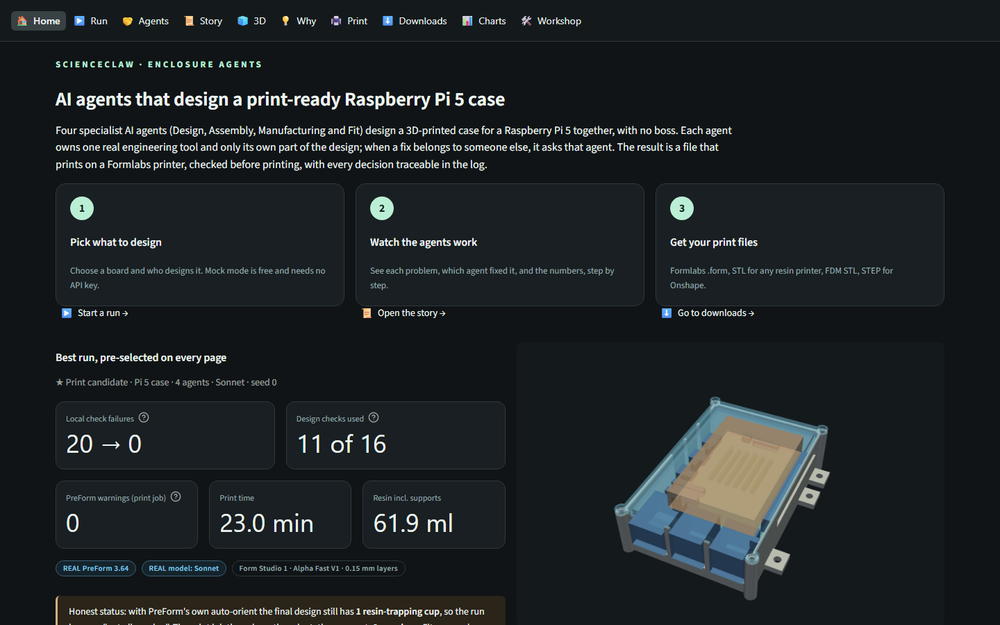
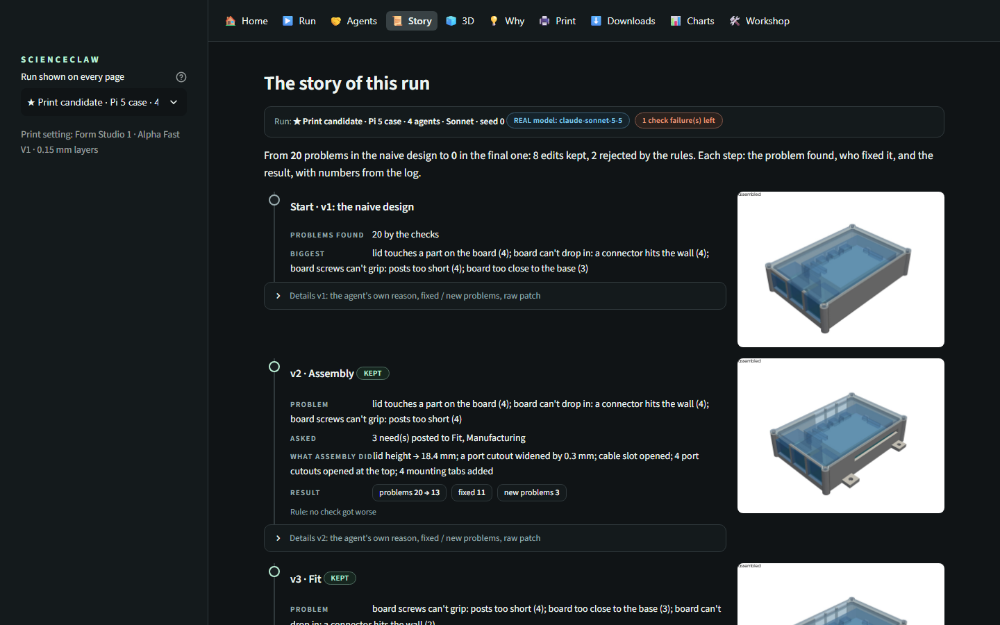
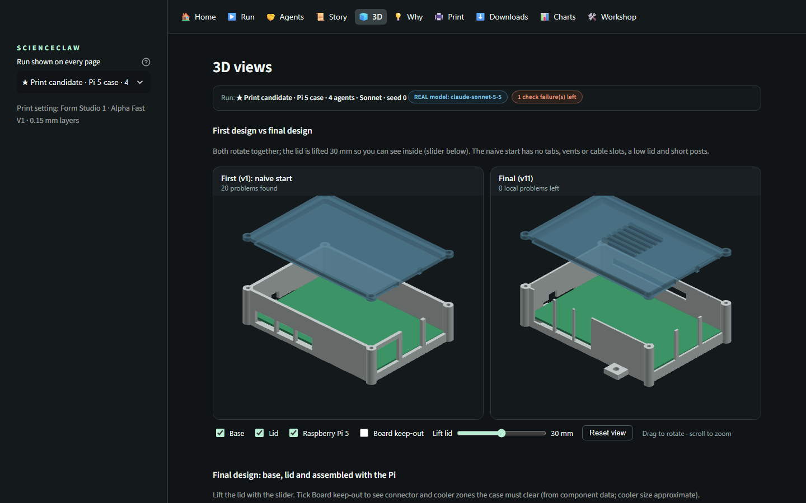

# ScienceClaw · Enclosure agents: AI agents that design print-ready parts

Four specialist AI agents (Design, Assembly, Manufacturing, Fit) design a 3D-printed Raspberry Pi 5 + Active Cooler
case together, **with no boss**. Each agent owns one real tool (CadQuery, an assembly check, Formlabs PreForm, fit
rules) and only its own part of the design spec; a fix in someone else's part becomes a request to that owner, and
plain code keeps an edit only if no check gets worse. Every decision is logged and traceable.

**Best run** (`a_pi5_standard__collective__generic__s0__claude-sonnet-5-5`, 4 agents, Claude Sonnet): local check
failures **20 → 0**. Real PreForm with its own auto-orient still found **1 resin-trapping cup**; the print job, with
the orientation chosen by the Manufacturing agent's orientation tool, has **0 warnings, 23.0 min, 61.9 ml** on one
Form Studio 1 platform (Alpha Fast V1, 0.15 mm). **Benchmark** (Claude Haiku, brief a, 3 seeds per mode): mean
failures left team 4, one generalist 6, one shot 20; no run passed every check, and the team costs more per run.
The Sonnet benchmark is incomplete (4 of 18 runs), so we make no Sonnet benchmark claims.

| Home | Story | 3D |
|---|---|---|
|  |  |  |

Part of the team project ScienceClaw (MIT ScienceClaw hackathon 2026): this branch (`Mo_ver`) holds the
enclosure agents; `Jash_ver` holds the bracket designer with CalculiX simulation.

## Where everything is

| you want | go to |
|---|---|
| the app | `app.py` (new UI, pages in `ui/`); the previous UI is `app_classic.py` |
| files to print | `results/print/README.md` (Formlabs .form, SLA STL, FDM STL, STEP for Onshape) |
| before printing | `results/print/RISK_CHECK.md` (unverified sizes, ruler checks), `results/print/ASSEMBLY.md` (screws, steps) |
| submission material | `results/submission/`: `slides.pptx`, `slides.pdf`, `demo.mp4`, `SUBMISSION.md`, `images/`, `TEAM_MERGE_GUIDE.md` |
| the 3-minute demo script | `DEMO.md` (IF PRINTED / IF NOT PRINTED versions, backup plan) |
| benchmark tables | `results/benchmark/sonnet_vs_haiku.md`, `runs_haiku_v2_summary.md` |
| the best run's log | `results/demo_run/<run>/log.md` (a copy of the run, so the app works on a fresh clone) |
| UI audit | `results/ui_audit/UI_AUDIT.md` (before / after screenshots) |

Labels are kept everywhere: **MOCK** (stand-in model or estimate), **UNVERIFIED** (size from a drawing or a typical
part, not measured), **EXPERIMENTAL** (free-form part family).

## Quick start (no API key needed)

    py -3.13 -m venv .venv
    .venv\Scripts\python.exe -m pip install -r requirements.txt
    .venv\Scripts\python.exe -m streamlit run app.py

The app opens on Home with the best real run pre-selected. On the **Run** page, **Mock** is on by default: a
rule-based stand-in model (labelled MOCK) runs the full loop with no API cost. For real models, copy `.env.example`
to `.env` and put your `ANTHROPIC_API_KEY` there (never committed), then turn Mock off.
Real PreForm checks need PreFormServer (next section); without it, PreForm results fall back to a labelled MOCK
estimate, and the saved real results are still shown.

## Setup details (Windows PowerShell)

Printer, material and layer thickness are ONE setting (`print:` in `config.yaml`) used for every print and
recorded in every output (`PRINT_SETTINGS.json`) and run log. The fit-test results only apply to that combination.

    py -3.13 -m venv .venv
    .venv\Scripts\python.exe -m pip install -r requirements.txt
    copy .env.example .env      # put ANTHROPIC_API_KEY in .env (never committed)

## PreFormServer setup (real print checks)

1. Install Formlabs PreForm 3.64.2 on this PC. PreFormServer ships with it (`PreFormServer.exe` in the PreForm
   install folder; Formlabs also offers it as a separate download for the Local API).
2. Start it on the port this project expects:  `PreFormServer.exe --port 44388`
3. Check it answers:  `curl http://127.0.0.1:44388/v1/`  ->  `{"version":"3.64.2..."}`
4. Printer / material / layer come from `config.yaml` `print:` (Form Studio 1 = `CLRK-1-2`, Alpha Fast V1 =
   `FLAPFA01`, 0.15 mm). To list what your PreForm knows:
   `.venv\Scripts\python.exe -c "from cad.common import load_config; from checks.preform_check import preform_settings; from checks.preform_client import PreFormClient; print([r for r in PreFormClient(preform_settings(load_config())).list_materials() if 'Studio' in str(r['printer'])])"`
5. Only one PreForm job runs at a time across all processes (file lock `results/cache/preform.lock`).
If the server is down, every PreForm result falls back to a MOCK that is labelled everywhere.

## What is where

| Folder | What |
|---|---|
| `components/` | `rpi5.yaml`, `active_cooler.yaml`, `arduino_uno.yaml`, `rpi_pico.yaml`, `sources.md` (a source for every number; UNVERIFIED where marked) |
| `data/fit_test_results.yaml` | hand-filled tolerance test results (template) |
| `cad/` | `test_print.py` (Phase 1), `fit_check.py` (Phase 2 frame), `spec.py` (JSON feature spec + validator), `enclosure.py` (generator), `render.py`, `prepare_forms.py` (.form files) |
| `checks/` | `assembly.py`, `printability.py`, `preform_check.py` (+ teammate's `preform_client.py`), `fit_rules.py`; tests in `checks/tests` |
| `core/` | `board.py` (SQLite shared board), `protocol.py` (ALL coordination rules), `llm.py`, `evaluate.py`, `report.py` |
| `agents/` | `design`, `assembly`, `manufacturing`, `fit`, `generalist`, plus `mock_policy.py` (rule-based fake model) |
| `benchmark/` | `briefs/` (a-d), `run_benchmark.py`, `metrics.py` |
| `run.py`, `app.py`, `ui/` | one design run; web UI (`app_classic.py` = previous UI) |

## Commands

    .venv\Scripts\python.exe -m cad.test_print                 # Phase 1 plate + key
    .venv\Scripts\python.exe -m cad.fit_check                  # Phase 2 fit-check frame
    .venv\Scripts\python.exe -m cad.enclosure generic          # Phase 3 v0 enclosure (or: measured)
    .venv\Scripts\python.exe -m cad.prepare_forms results\test_print   # real PreForm .form per STL
    .venv\Scripts\python.exe -m cad.print_job out.form base.stl lid.stl   # several parts on ONE platform, zero warnings
    .venv\Scripts\python.exe run.py --mode collective --brief benchmark\briefs\a_pi5_standard.yaml --budget 12 --seed 0 [--mock] [--clearances measured] [--model claude-sonnet-5-5]
    .venv\Scripts\python.exe -m benchmark.run_benchmark --briefs a --seeds 3 --workers 2 --resume [--mock] [--out runs_sonnet]
    .venv\Scripts\python.exe -m benchmark.metrics results\benchmark\runs_sonnet   # table + charts from the logs
    .venv\Scripts\python.exe -m streamlit run app.py
    .venv\Scripts\python.exe -m pytest checks core families tests   # tests\ = Streamlit AppTest of every page
    .venv\Scripts\python.exe scripts\make_submission_images.py      # renders + charts from the logs
    .venv\Scripts\python.exe scripts\make_slides.py                 # slides.pptx + slides.pdf
    .venv\Scripts\python.exe scripts\record_demo.py                 # demo.mp4 + demo.gif

## Fair comparison

Every mode (one-shot, generalist, collective) starts from the **same naive spec** (`cad/spec.py naive_spec`:
closed box, port cutouts, no tabs, vents or cable slots, low lid, short standoffs) with the same model, tools,
brief and evaluation budget. Passing every check is the minimum: after that, agents keep improving the
**quality score** (`config.yaml quality:`, computed in `core/quality.py` from logged data: part volume, print
height, real PreForm warnings, clearance margin, assembly margin, extra features) until the budget runs out.
Every run reports pass/fail and the quality score.

## How the agents coordinate (core/protocol.py)

No boss. Agents post on a shared SQLite board. Each top-level spec key has one owner (enforced in code).
A failure whose fix lies in another agent's keys becomes a **need** to that owner (agents post needs, and the
protocol also routes them automatically); every agent handles its open needs first, biggest first.
A patch touching another agent's keys is a **joint edit**, evaluated only if that owner supports it.
Every proposal comes with a per-failure breakdown (fixed / broken / better / worse). An edit is accepted if no
check gets worse; otherwise owners of worsened checks object with numbers, the others vote, and it passes only
if total failures go down and supporters outnumber objectors. Once everything passes, an edit must keep every
check passing and raise the quality score. A budget of full evaluations ends each run. Real PreForm runs only
when the Manufacturing agent (or generalist) asks, and on every final design (cached by spec).

## Model choice (step 1d, 2026-10-31)

Same model for every agent in a run. Brief a, seed 0, budget 12, after the needs/joint-edit/improve-phase fixes:

| run | local check failures | cost | failures fixed per $ |
|---|---|---|---|
| collective, claude-haiku-5-5 | 20 -> 0, then quality 51.4 -> 52.5 | $0.026 | ~760 |
| collective, claude-sonnet-5-5 | 20 -> 0, stopped after 7 evaluations | $0.433 | ~46 |
| generalist, claude-sonnet-5-5 | 20 -> 0, stopped after 3 evaluations | $0.103 | ~190 |
| generalist, claude-haiku-5-5 (earlier prompt) | 20 -> 8 | $0.018 | ~690 |

The benchmark uses **claude-haiku-5-5** (progress per dollar). Both collective finals still had 1 real PreForm cup.

## Part families

`families/` holds everything part-specific behind one interface (`families/base.py`): spec schema, default spec,
generator, family checks, quality, fix hints, renders, key/check ownership. The board, protocol, agents, PreForm
and fit code are shared. `enclosure` is the board enclosure; `freeform` (**EXPERIMENTAL**) lets the Design agent
write CadQuery code from a text description (brief `e_freeform_peg_block.yaml`). Only general checks run:
PreForm, wall thickness, interference between parts, fit clearances on mating pairs. Model-written code runs in
a separate isolated process with a timeout after an AST check (cadquery/math imports only); this lowers the risk
but is not a sandbox.

## Tools (not used in the benchmark)

- `checks/thickness_map.py` (Manufacturing): wall-thickness heat map image (app: Tools page).
- `checks/orientations.py` (Manufacturing): compare 2-4 print orientations in PreForm (support volume, cups, time).
