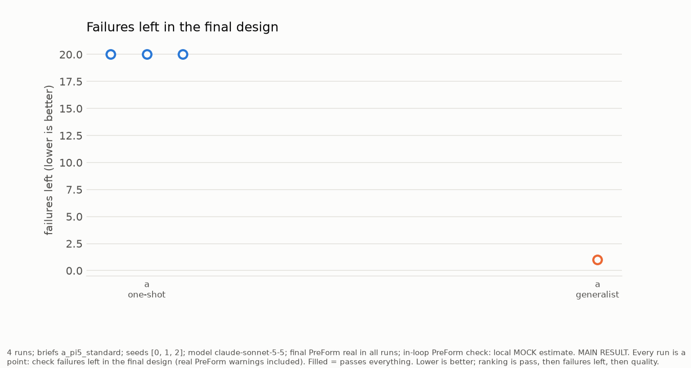
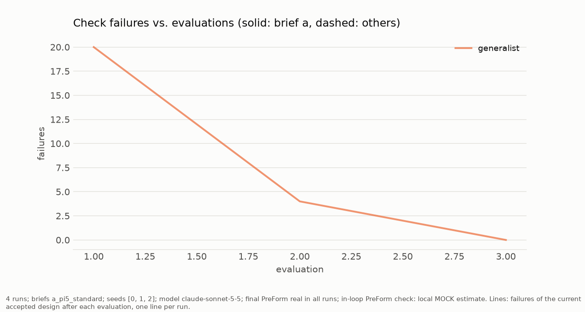
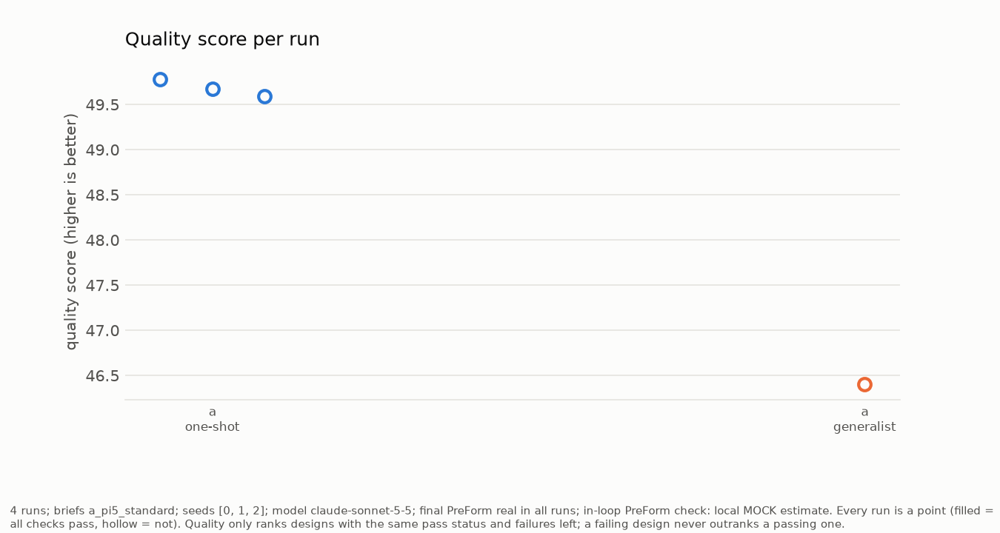
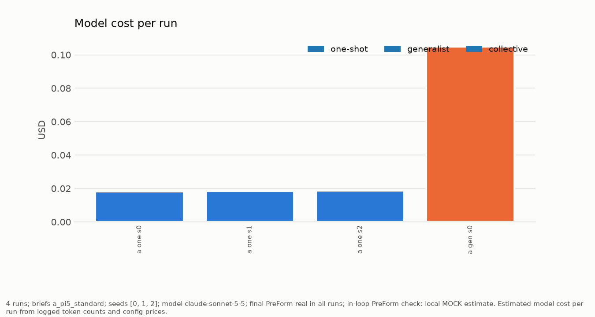
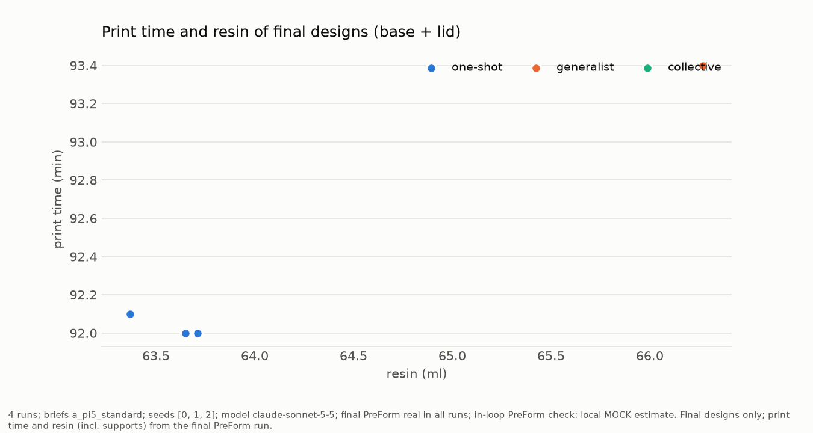
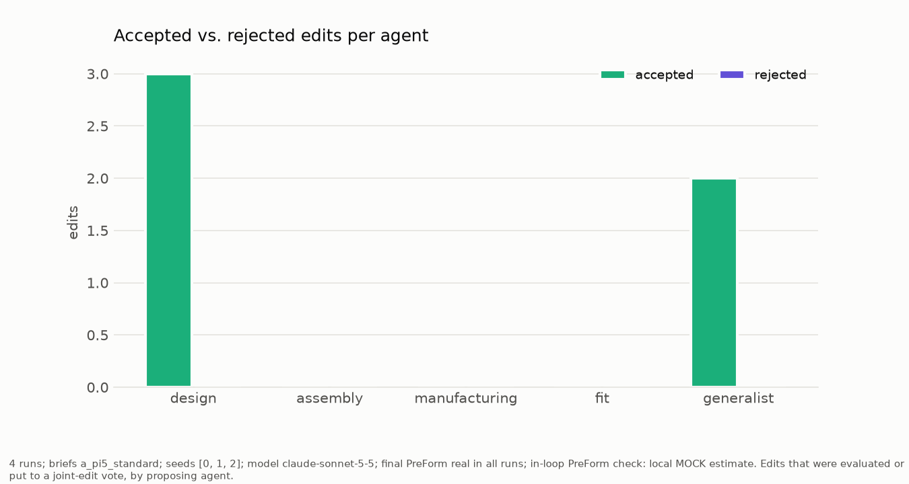

# Benchmark summary (runs_sonnet)

_4 runs; briefs a_pi5_standard; seeds [0, 1, 2]; model claude-sonnet-5-5; final PreForm real in all runs; in-loop PreForm check: local MOCK estimate._

Print: Alpha Fast V1, 0.15 mm layers; clearances generic; every mode starts from the same naive spec. Failures are counted by our own checks.
Ranking: passes everything, then fewest failures left, then quality score (best_rank = best run's rank among all runs in this set).

| brief | mode | runs | passed | failures_left_mean | best_rank | quality_mean | quality_min_max | evals_to_pass | edits_prop_acc | preform_warnings | print_min | resin_ml | seconds | cost_usd |
|---|---|---|---|---|---|---|---|---|---|---|---|---|---|---|
| a_pi5_standard | generalist | 1 | 0/1 | 1 | 1 | 46.4 | 46.4..46.4 | 3 | 2/2 | 1 | 93.4 | 66.27 | 253.1 | 0.1 |
| a_pi5_standard | one_shot | 3 | 0/3 | 20 | 2 | 49.68 | 49.59..49.78 | None | 1/1 | 0 | 92.03 | 63.58 | 244.5 | 0.02 |

_4 runs; briefs a_pi5_standard; seeds [0, 1, 2]; model claude-sonnet-5-5; final PreForm real in all runs; in-loop PreForm check: local MOCK estimate. MAIN RESULT. Every run is a point: check failures left in the final design (real PreForm warnings included). Filled = passes everything. Lower is better; ranking is pass, then failures left, then quality._

_4 runs; briefs a_pi5_standard; seeds [0, 1, 2]; model claude-sonnet-5-5; final PreForm real in all runs; in-loop PreForm check: local MOCK estimate. Lines: failures of the current accepted design after each evaluation, one line per run._

_4 runs; briefs a_pi5_standard; seeds [0, 1, 2]; model claude-sonnet-5-5; final PreForm real in all runs; in-loop PreForm check: local MOCK estimate. Every run is a point (filled = all checks pass, hollow = not). Quality only ranks designs with the same pass status and failures left; a failing design never outranks a passing one._

_4 runs; briefs a_pi5_standard; seeds [0, 1, 2]; model claude-sonnet-5-5; final PreForm real in all runs; in-loop PreForm check: local MOCK estimate. Estimated model cost per run from logged token counts and config prices._

_4 runs; briefs a_pi5_standard; seeds [0, 1, 2]; model claude-sonnet-5-5; final PreForm real in all runs; in-loop PreForm check: local MOCK estimate. Final designs only; print time and resin (incl. supports) from the final PreForm run._

_4 runs; briefs a_pi5_standard; seeds [0, 1, 2]; model claude-sonnet-5-5; final PreForm real in all runs; in-loop PreForm check: local MOCK estimate. Edits that were evaluated or put to a joint-edit vote, by proposing agent._
