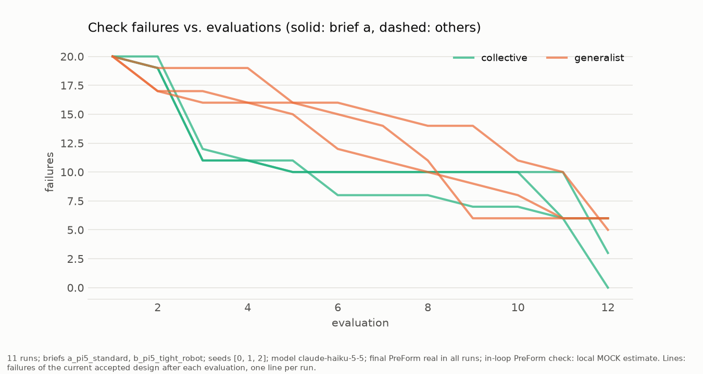
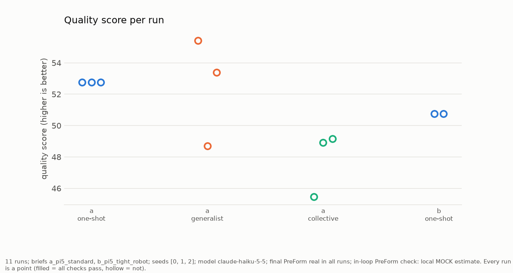
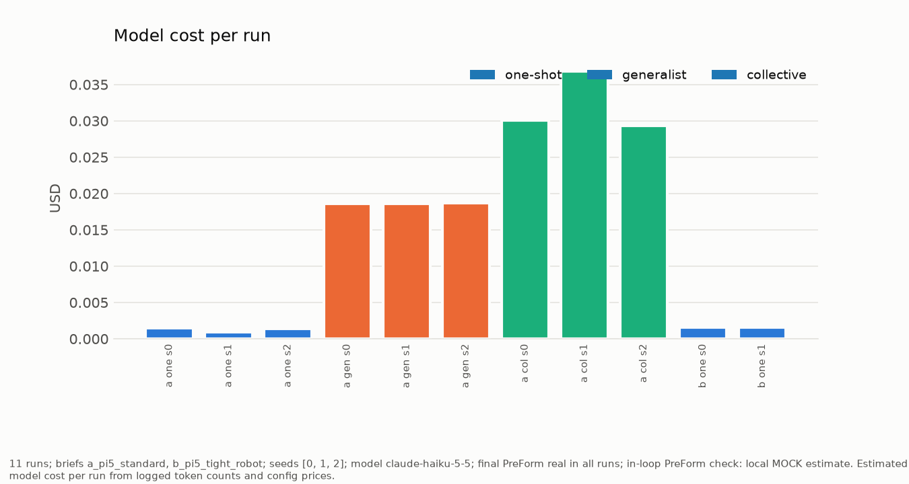
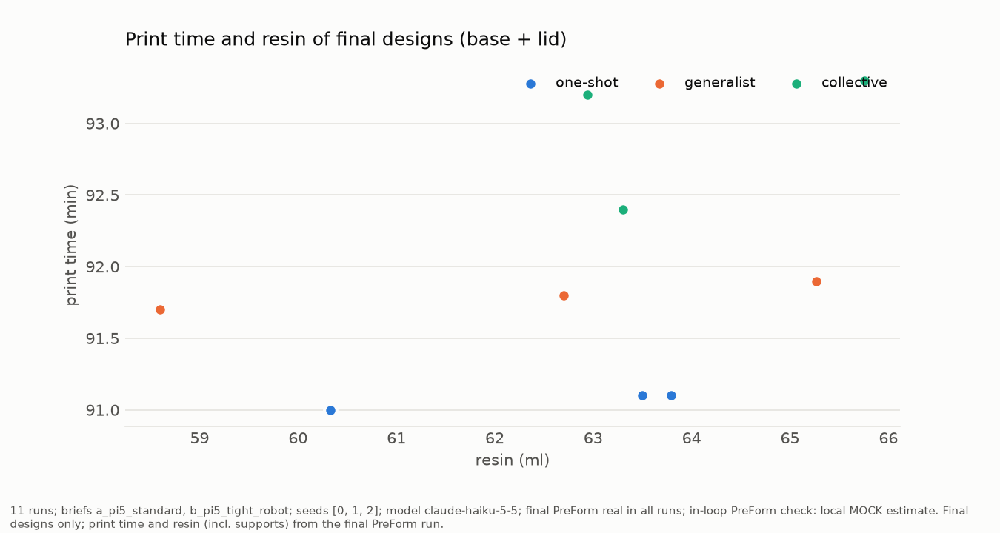
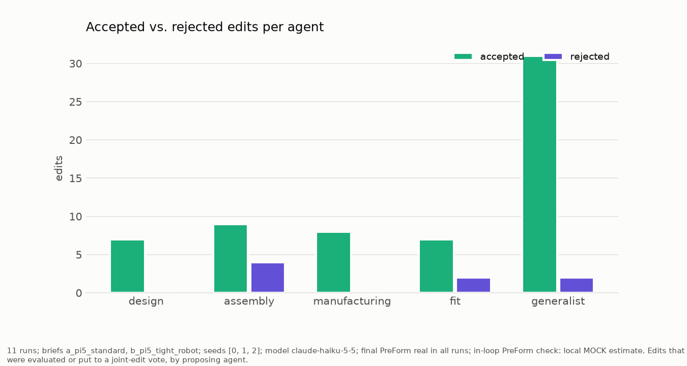

# Benchmark summary (runs_v2)

_11 runs; briefs a_pi5_standard, b_pi5_tight_robot; seeds [0, 1, 2]; model claude-haiku-5-5; final PreForm real in all runs; in-loop PreForm check: local MOCK estimate._

Print: Alpha Fast V1, 0.15 mm layers; clearances generic; every mode starts from the same naive spec. Failures are counted by our own checks.

| brief | mode | runs | passed | quality_mean | quality_min_max | failures_mean | evals_to_pass | edits_prop_acc | preform_warnings | print_min | resin_ml | seconds | cost_usd |
|---|---|---|---|---|---|---|---|---|---|---|---|---|---|
| a_pi5_standard | one_shot | 3 | 0/3 | 52.76 | 52.76..52.76 | 20 | None | 0.67/0.67 | 0 | 91.1 | 63.59 | 146.03 | 0.0 |
| a_pi5_standard | generalist | 3 | 0/3 | 52.5 | 48.71..55.42 | 6 | None | 11/10.33 | 0.33 | 91.8 | 62.19 | 472.67 | 0.02 |
| a_pi5_standard | collective | 3 | 0/3 | 47.84 | 45.45..49.15 | 4 | 12 | 11/9 | 1 | 92.97 | 64.0 | 1129.13 | 0.03 |
| b_pi5_tight_robot | one_shot | 2 | 0/2 | 50.76 | 50.76..50.76 | 25 | None | 1/1 | 0 | 91.05 | 62.06 | 404.8 | 0.0 |

_11 runs; briefs a_pi5_standard, b_pi5_tight_robot; seeds [0, 1, 2]; model claude-haiku-5-5; final PreForm real in all runs; in-loop PreForm check: local MOCK estimate. Lines: failures of the current accepted design after each evaluation, one line per run._

_11 runs; briefs a_pi5_standard, b_pi5_tight_robot; seeds [0, 1, 2]; model claude-haiku-5-5; final PreForm real in all runs; in-loop PreForm check: local MOCK estimate. Every run is a point (filled = all checks pass, hollow = not)._

_11 runs; briefs a_pi5_standard, b_pi5_tight_robot; seeds [0, 1, 2]; model claude-haiku-5-5; final PreForm real in all runs; in-loop PreForm check: local MOCK estimate. Estimated model cost per run from logged token counts and config prices._

_11 runs; briefs a_pi5_standard, b_pi5_tight_robot; seeds [0, 1, 2]; model claude-haiku-5-5; final PreForm real in all runs; in-loop PreForm check: local MOCK estimate. Final designs only; print time and resin (incl. supports) from the final PreForm run._

_11 runs; briefs a_pi5_standard, b_pi5_tight_robot; seeds [0, 1, 2]; model claude-haiku-5-5; final PreForm real in all runs; in-loop PreForm check: local MOCK estimate. Edits that were evaluated or put to a joint-edit vote, by proposing agent._
